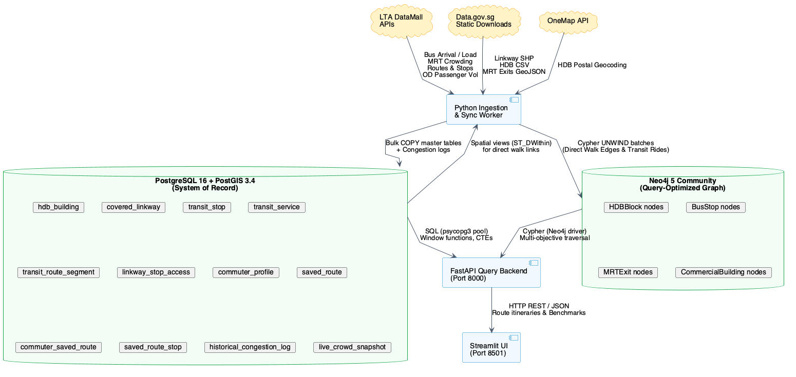
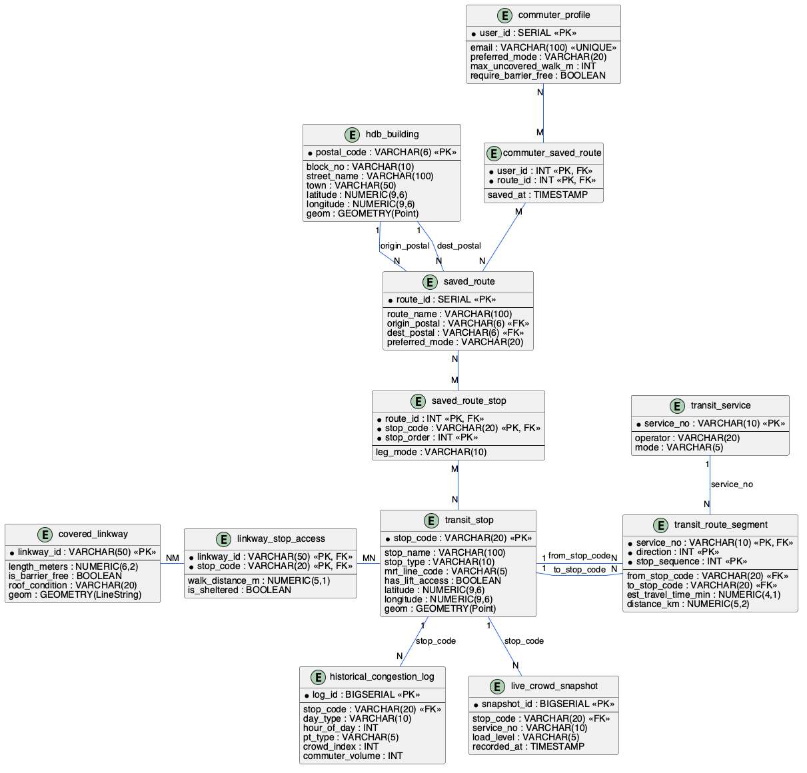

# TRANSIQ

**Course:** INF2003 Database Systems  
**Weightage:** 50% of Final Grade (25% Relational + 25% Non-Relational)  
**Target Grade:** A+ (>=80%, Excellent Band)

## Problem

Google Maps, Apple Maps, and Citymapper optimize strictly for shortest travel time and ignore Singapore specific conditions: tropical downpours, unsheltered walks across open car parks, packed MRT platforms, and over 100 km of covered linkways built under the Walk2Ride Programme. Commuters get routed through 250m of open rain to save 45 seconds, or crowded onto crush-load (LSD) transit when a seated bus route exists.

## Goal

Build a door-to-door transit routing engine that optimizes for shelter from rain and sun, seat availability, and minimal transfers using Singapore government open data. The backend relies on a dual-database architecture: PostgreSQL with PostGIS for relational infrastructure, user profiles, and spatial analytics, paired with Neo4j for multi-modal graph pathfinding.

## Core Concepts

TRANSIQ is a door-to-door multi-modal transit router for Singapore using a dual-database system.

- Singapore transit problem with real-world open data: Prioritizes covered linkways and live bus and train crowding levels (SEA, SDA, LSD) using 10 government datasets.
- Justification for dual database: Graph traversal avoids recursive multi-table SQL joins during routing queries. PostgreSQL with PostGIS handles ACID transactions, spatial indexing, analytical queries, and relational integrity.
- Database-first design: BCNF normalized schema with 12 tables, advanced SQL (recursive CTE, window functions, nested subqueries, views, set operations), Cypher graph traversal, and query execution plan optimization.

## Three Commuter Modes

Commuter preferences are scored by default using weighted soft penalties to ensure that valid routes are always discovered. An optional strict filter toggle is available for commuters who require absolute compliance.

| Mode | Optimization Focus | Default Soft Weighting | Optional Strict Filter |
| :--- | :--- | :--- | :--- |
| Rain & Sun Shield | Maximize walking under covered linkways | Penalizes unsheltered walking distance (0.05 min/meter) | Rejects routes with unsheltered walks exceeding threshold |
| Comfort & Seats | Avoid crowded platforms and packed buses | Penalizes crowded legs (15 min penalty for LSD load) | Rejects any route containing LSD bus segments |
| Least Transfers | Minimize vehicle transfers and steps | Penalizes each vehicle transfer (10 min penalty) | Hard cap at 0 to 1 transfer, enforces barrier-free access |

## Datasets

### Access Registration

| Key | Registration URL | Data Unlocked |
| :--- | :--- | :--- |
| LTA DataMall AccountKey | https://datamall.lta.gov.sg/content/datamall/en/request-for-api.html | Bus arrival, platform crowdedness, stops, routes, passenger volume OD |
| OneMap API Token | https://www.onemap.gov.sg/apidocs/register | HDB postal code geocoding and coordinates |

### Dataset Inventory

| # | Dataset | Type | Format | Records | Role in TRANSIQ |
| :- | :--- | :--- | :--- | :--- | :--- |
| 1 | Covered Linkway Network | Static download | Shapefile (ZIP) | 10K+ segments | Sheltered walking graph |
| 2 | HDB Property Information | Static + API | CSV / JSON | 13,357 rows | Origin and destination anchors |
| 3 | OneMap Search API | REST API | JSON | Per query | HDB geocoding to postal and coordinates |
| 4 | Bus Arrival & Live Load | REST API (live) | JSON | Per stop | Real-time bus crowding (SEA, SDA, LSD) |
| 5 | Station Crowd Density RT | REST API (live) | JSON | Per line | Real-time MRT crowd levels |
| 6 | Bus Stops | REST API | JSON | ~5,000 stops | Stop coordinates and descriptions |
| 7 | Bus Routes | REST API | JSON | Full sequences | Service stop sequences and distance |
| 8 | MRT/LRT Station Exits | Static download | GeoJSON | 160+ stations | Exit coordinates for transfers |
| 9 | Passenger Volume OD (Train) | REST API to CSV | CSV | ~907K rows/month | Historical train congestion analytics |
| 10 | Passenger Volume OD (Bus) | REST API to CSV | CSV | ~6.1M rows/month | Historical bus congestion analytics |

### Ingestion Sampling Strategy (Option C: Calibrated Stratified Sampling)

Loading 7M raw monthly OD rows directly creates redundant memory pressure without adding structural graph connectivity. TRANSIQ uses a calibrated stratified sampling strategy optimized for statistical benchmarking validity and cache escape:

1. Structural Metadata (100% Complete Islandwide): Ingest all 5,209 authentic bus stops, 165 MRT stations, 330 MRT exits from LTA DataMall, and all 7,183 covered linkway segments from LTA Walk2Ride.
2. Stratified Residential Anchors: Ingest 4,500 HDB blocks stratified proportionally across all 24 Singapore planning towns (~185 blocks/town) with verified anchor postal codes.
3. Congestion Records (Representative Peak-Hour Window): Sample 450,000 historical congestion records across weekday morning (07:00-09:00) and evening (17:00-19:00) peak windows.
4. Cache Escape Working Set: Total database working set scales to ~150-200 MB, escaping CPU L3 cache (16-32 MB) by 5x. This ensures genuine PostgreSQL `shared_buffers` page cycling, 3-level B-Tree index traversal, and statistically sound P95/P99 latency variance during benchmarks.
### Static and API Dataset Breakdown

| Source Category | Datasets Included | Total Count |
| :--- | :--- | :--- |
| Static download (no auth) | Covered Linkway (SHP), HDB Property Info (CSV), MRT Exits (GeoJSON) | 3 |
| REST API (LTA AccountKey) | Bus Arrival, Crowd Density, Bus Stops, Bus Routes, Passenger OD | 6 |
| REST API (OneMap token) | OneMap Search (HDB geocoding) | 1 |

### API References

- LTA DataMall API User Guide v6.9: https://datamall.lta.gov.sg/content/dam/datamall/datasets/LTA_DataMall_API_User_Guide.pdf
- LTA DataMall Terms of Service: https://datamall.lta.gov.sg/content/datamall/en/api-terms-of-service.html
- LTA DataMall Static Datasets: https://datamall.lta.gov.sg/content/datamall/en/static-data.html
- LTA DataMall Dynamic Datasets: https://datamall.lta.gov.sg/content/datamall/en/dynamic-data.html
- Data.gov.sg Public API: https://api-open.data.gov.sg/v1/public/api/datasets
- OneMap API Documentation: https://www.onemap.gov.sg/apidocs/

## System Architecture

TRANSIQ follows a 3-tier architecture with clean separation between presentation, query orchestration, and database storage.



### Dual-Database Justification and Division of Labor

- PostgreSQL with PostGIS (System of Record): Stores normalized BCNF tables, ACID transaction logs, user profiles, and spatial geometries. PostGIS computes spatial buffers (ST_DWithin) to pre-calculate pedestrian accessibility between HDBs and transit stops.
- Neo4j (Query-Optimized Graph Projection): Handles multi-modal path traversal. Rather than computing recursive multi-table SQL joins, Neo4j navigates physical pointers between stops, routes, and walkways.
- Cross-Database Natural Keys: Engines run independently on separate ports (5432 and 7687). They link through business keys such as stop_code and postal_code.
- Relational-to-Graph ETL (sync_pg_to_neo4j.py): Reads relational spatial views from PostgreSQL and projects nodes and relationships into Neo4j using batched Cypher UNWIND transactions.

## ER Diagram

Entity-Relationship model in Crow's Foot notation showing all 12 relations and constraints:



### Relationship Summary

| Relationship | Cardinality | Implementation Mechanism |
| :--- | :--- | :--- |
| hdb_building to saved_route (origin) | 1:N | Foreign key saved_route.origin_postal |
| hdb_building to saved_route (dest) | 1:N | Foreign key saved_route.dest_postal |
| commuter_profile to saved_route | M:N | Junction table commuter_saved_route |
| saved_route to transit_stop | M:N | Junction table saved_route_stop |
| transit_service to transit_route_segment | 1:N | Foreign key transit_route_segment.service_no |
| transit_stop to transit_route_segment (from) | 1:N | Foreign key transit_route_segment.from_stop_code |
| transit_stop to transit_route_segment (to) | 1:N | Foreign key transit_route_segment.to_stop_code |
| covered_linkway to transit_stop | M:N | Junction table linkway_stop_access |
| transit_stop to historical_congestion_log | 1:N | Foreign key historical_congestion_log.stop_code |
| transit_stop to live_crowd_snapshot | 1:N | Foreign key live_crowd_snapshot.stop_code |

## Relational Schema

```sql
CREATE EXTENSION IF NOT EXISTS postgis;

CREATE TABLE hdb_building (
    postal_code VARCHAR(6) PRIMARY KEY,
    block_no    VARCHAR(10)  NOT NULL,
    street_name VARCHAR(100) NOT NULL,
    town        VARCHAR(50)  NOT NULL,
    latitude    NUMERIC(9,6) NOT NULL,
    longitude   NUMERIC(9,6) NOT NULL,
    geom        GEOMETRY(Point, 4326) NOT NULL,
    created_at  TIMESTAMP DEFAULT CURRENT_TIMESTAMP,
    CONSTRAINT chk_postal_len CHECK (LENGTH(postal_code) = 6),
    CONSTRAINT chk_lat_range  CHECK (latitude  BETWEEN 1.0 AND 1.5),
    CONSTRAINT chk_lon_range  CHECK (longitude BETWEEN 103.0 AND 104.5)
);
CREATE INDEX idx_hdb_geom ON hdb_building USING GIST (geom);

CREATE TABLE covered_linkway (
    linkway_id        VARCHAR(50) PRIMARY KEY,
    length_meters     NUMERIC(6,2) NOT NULL CHECK (length_meters > 0),
    is_barrier_free   BOOLEAN DEFAULT TRUE,
    roof_condition    VARCHAR(20) DEFAULT 'GOOD'
        CHECK (roof_condition IN ('GOOD', 'DAMAGED', 'UNDER_MAINTENANCE')),
    geom              GEOMETRY(LineString, 4326) NOT NULL
);
CREATE INDEX idx_linkway_geom ON covered_linkway USING GIST (geom);

CREATE TABLE transit_stop (
    stop_code       VARCHAR(20) PRIMARY KEY,
    stop_name       VARCHAR(100) NOT NULL,
    stop_type       VARCHAR(10)  NOT NULL
        CHECK (stop_type IN ('BUS_STOP', 'MRT_EXIT', 'LRT_STOP')),
    mrt_line_code   VARCHAR(5),
    has_lift_access BOOLEAN DEFAULT TRUE,
    latitude        NUMERIC(9,6) NOT NULL,
    longitude       NUMERIC(9,6) NOT NULL,
    geom            GEOMETRY(Point, 4326) NOT NULL
);
CREATE INDEX idx_transit_stop_geom ON transit_stop USING GIST (geom);

CREATE TABLE transit_service (
    service_no  VARCHAR(10) PRIMARY KEY,
    operator    VARCHAR(20) NOT NULL
        CHECK (operator IN ('SBST', 'SMRT', 'Tower', 'SLRT')),
    mode        VARCHAR(5)  NOT NULL
        CHECK (mode IN ('BUS', 'MRT', 'LRT'))
);

CREATE TABLE transit_route_segment (
    service_no          VARCHAR(10) NOT NULL
        REFERENCES transit_service(service_no) ON DELETE CASCADE,
    direction           INT NOT NULL CHECK (direction IN (1, 2)),
    stop_sequence       INT NOT NULL CHECK (stop_sequence > 0),
    from_stop_code      VARCHAR(20) NOT NULL
        REFERENCES transit_stop(stop_code) ON DELETE CASCADE,
    to_stop_code        VARCHAR(20) NOT NULL
        REFERENCES transit_stop(stop_code) ON DELETE CASCADE,
    est_travel_time_min NUMERIC(4,1) NOT NULL CHECK (est_travel_time_min > 0),
    distance_km         NUMERIC(5,2) NOT NULL CHECK (distance_km > 0),
    PRIMARY KEY (service_no, direction, stop_sequence)
);

CREATE TABLE linkway_stop_access (
    linkway_id      VARCHAR(50) NOT NULL
        REFERENCES covered_linkway(linkway_id) ON DELETE CASCADE,
    stop_code       VARCHAR(20) NOT NULL
        REFERENCES transit_stop(stop_code) ON DELETE CASCADE,
    walk_distance_m NUMERIC(5,1) NOT NULL CHECK (walk_distance_m > 0),
    is_sheltered    BOOLEAN NOT NULL DEFAULT TRUE,
    PRIMARY KEY (linkway_id, stop_code)
);

CREATE TABLE commuter_profile (
    user_id              SERIAL PRIMARY KEY,
    email                VARCHAR(100) UNIQUE NOT NULL,
    preferred_mode       VARCHAR(20) DEFAULT 'RAIN_SHIELD'
        CHECK (preferred_mode IN ('RAIN_SHIELD', 'COMFORT_SEATS', 'LEAST_TRANSFERS', 'FASTEST')),
    max_uncovered_walk_m INT DEFAULT 50 CHECK (max_uncovered_walk_m >= 0),
    require_barrier_free BOOLEAN DEFAULT FALSE,
    created_at           TIMESTAMP DEFAULT CURRENT_TIMESTAMP
);

CREATE TABLE saved_route (
    route_id        SERIAL PRIMARY KEY,
    route_name      VARCHAR(100) NOT NULL,
    origin_postal   VARCHAR(6) NOT NULL
        REFERENCES hdb_building(postal_code),
    dest_postal     VARCHAR(6) NOT NULL
        REFERENCES hdb_building(postal_code),
    preferred_mode  VARCHAR(20) DEFAULT 'RAIN_SHIELD'
        CHECK (preferred_mode IN ('RAIN_SHIELD', 'COMFORT_SEATS', 'LEAST_TRANSFERS', 'FASTEST')),
    created_at      TIMESTAMP DEFAULT CURRENT_TIMESTAMP,
    CONSTRAINT chk_origin_ne_dest CHECK (origin_postal <> dest_postal)
);

CREATE TABLE commuter_saved_route (
    user_id    INT NOT NULL
        REFERENCES commuter_profile(user_id) ON DELETE CASCADE,
    route_id   INT NOT NULL
        REFERENCES saved_route(route_id) ON DELETE CASCADE,
    saved_at   TIMESTAMP DEFAULT CURRENT_TIMESTAMP,
    PRIMARY KEY (user_id, route_id)
);

CREATE TABLE saved_route_stop (
    route_id     INT NOT NULL
        REFERENCES saved_route(route_id) ON DELETE CASCADE,
    stop_code    VARCHAR(20) NOT NULL
        REFERENCES transit_stop(stop_code) ON DELETE CASCADE,
    stop_order   INT NOT NULL CHECK (stop_order > 0),
    leg_mode     VARCHAR(10) NOT NULL
        CHECK (leg_mode IN ('WALK', 'BUS', 'MRT', 'LRT')),
    PRIMARY KEY (route_id, stop_code, stop_order)
);

CREATE TABLE historical_congestion_log (
    log_id           BIGSERIAL PRIMARY KEY,
    stop_code        VARCHAR(20) NOT NULL
        REFERENCES transit_stop(stop_code),
    day_type         VARCHAR(10) NOT NULL
        CHECK (day_type IN ('WEEKDAY', 'WEEKEND', 'HOLIDAY')),
    hour_of_day      INT NOT NULL CHECK (hour_of_day BETWEEN 0 AND 23),
    pt_type          VARCHAR(5) NOT NULL
        CHECK (pt_type IN ('BUS', 'TRAIN')),
    crowd_index      INT NOT NULL CHECK (crowd_index BETWEEN 1 AND 10),
    commuter_volume  INT NOT NULL CHECK (commuter_volume >= 0)
);
CREATE INDEX idx_congestion_lookup
    ON historical_congestion_log (stop_code, day_type, hour_of_day);

CREATE TABLE live_crowd_snapshot (
    snapshot_id  BIGSERIAL PRIMARY KEY,
    stop_code    VARCHAR(20) NOT NULL
        REFERENCES transit_stop(stop_code),
    service_no   VARCHAR(10),
    load_level   VARCHAR(5) NOT NULL
        CHECK (load_level IN ('SEA', 'SDA', 'LSD', 'Low', 'Medium', 'High')),
    recorded_at  TIMESTAMP NOT NULL DEFAULT CURRENT_TIMESTAMP
);
CREATE INDEX idx_live_snapshot_stop ON live_crowd_snapshot (stop_code, recorded_at);
```

### Analytical Views

```sql
-- Materialized View for instant sheltered linkway access (O(1) indexed reads)
CREATE MATERIALIZED VIEW IF NOT EXISTS mv_sheltered_access AS
SELECT
    h.postal_code, h.block_no, h.town,
    l.linkway_id, l.is_barrier_free, l.roof_condition,
    lsa.walk_distance_m, lsa.is_sheltered
FROM hdb_building h
JOIN linkway_stop_access lsa ON lsa.stop_code IN (
    SELECT stop_code FROM transit_stop
    WHERE ST_DWithin(h.geom::geography, geom::geography, 500)
)
JOIN covered_linkway l ON l.linkway_id = lsa.linkway_id;

CREATE UNIQUE INDEX IF NOT EXISTS idx_mv_sheltered_access_pk
    ON mv_sheltered_access (postal_code, linkway_id);

-- Dynamic view wrapper for backwards compatibility
CREATE OR REPLACE VIEW v_sheltered_access AS
SELECT * FROM mv_sheltered_access;

-- Concurrently refreshable routine
CREATE OR REPLACE FUNCTION refresh_sheltered_access()
RETURNS VOID AS $$
BEGIN
    REFRESH MATERIALIZED VIEW CONCURRENTLY mv_sheltered_access;
END;
$$ LANGUAGE plpgsql;

CREATE VIEW v_peak_congestion AS
SELECT
    stop_code,
    hour_of_day,
    commuter_volume,
    crowd_index,
    AVG(commuter_volume) OVER (
        PARTITION BY stop_code ORDER BY hour_of_day
        ROWS BETWEEN 1 PRECEDING AND 1 FOLLOWING
    ) AS rolling_3hr_avg,
    DENSE_RANK() OVER (
        PARTITION BY hour_of_day ORDER BY commuter_volume DESC
    ) AS congestion_rank
FROM historical_congestion_log
WHERE day_type = 'WEEKDAY' AND hour_of_day BETWEEN 7 AND 9;

CREATE VIEW v_comfort_routes AS
SELECT
    sr.route_id, sr.route_name, srs.stop_code, srs.leg_mode,
    srs.stop_order, ts.stop_name
FROM saved_route sr
JOIN saved_route_stop srs ON sr.route_id = srs.route_id
JOIN transit_stop ts ON srs.stop_code = ts.stop_code
WHERE sr.preferred_mode = 'COMFORT_SEATS'
ORDER BY sr.route_id, srs.stop_order;
```

## Normalization and BCNF

All 12 relations satisfy Boyce-Codd Normal Form. For every non-trivial functional dependency X -> Y, X is a superkey:

| Relation | Primary Key | Non-trivial Functional Dependencies | Superkey Check | BCNF Satisfied |
| :--- | :--- | :--- | :--- | :--- |
| hdb_building | postal_code | postal_code -> block_no, street_name, town, lat, lon, geom | Primary key | Yes |
| covered_linkway | linkway_id | linkway_id -> length_meters, is_barrier_free, roof_condition, geom | Primary key | Yes |
| transit_stop | stop_code | stop_code -> stop_name, stop_type, mrt_line_code, has_lift, lat, lon, geom | Primary key | Yes |
| transit_service | service_no | service_no -> operator, mode | Primary key | Yes |
| transit_route_segment | (service_no, direction, stop_sequence) | -> from_stop_code, to_stop_code, est_travel_time_min, distance_km | Composite key | Yes |
| linkway_stop_access | (linkway_id, stop_code) | -> walk_distance_m, is_sheltered | Composite key | Yes |
| commuter_profile | user_id | user_id -> email, preferred_mode; email -> user_id (UNIQUE) | Both superkeys | Yes |
| saved_route | route_id | route_id -> route_name, origin_postal, dest_postal, preferred_mode | Primary key | Yes |
| commuter_saved_route | (user_id, route_id) | -> saved_at | Composite key | Yes |
| saved_route_stop | (route_id, stop_code, stop_order) | -> leg_mode | Composite key | Yes |
| historical_congestion_log | log_id | log_id -> stop_code, day_type, hour, crowd_index, commuter_volume | Primary key | Yes |
| live_crowd_snapshot | snapshot_id | snapshot_id -> stop_code, service_no, load_level, recorded_at | Primary key | Yes |

No transitive dependencies exist. Junction tables use composite primary keys where all non-key attributes depend on the full key.

## Advanced SQL Queries

### 1. Nested Subquery with NOT EXISTS: Find Unsheltered Stops

```sql
SELECT ts.stop_code, ts.stop_name, ts.stop_type
FROM transit_stop ts
WHERE ts.stop_type = 'BUS_STOP'
  AND NOT EXISTS (
      SELECT 1 FROM linkway_stop_access lsa
      JOIN covered_linkway l ON lsa.linkway_id = l.linkway_id
      WHERE lsa.stop_code = ts.stop_code
        AND lsa.is_sheltered = TRUE
        AND lsa.walk_distance_m <= 200
  )
ORDER BY ts.stop_name;
```

### 2. Aggregate with GROUP BY / HAVING: Congested Stops

```sql
SELECT
    ts.stop_name,
    hcl.pt_type,
    SUM(hcl.commuter_volume) AS total_morning_volume,
    AVG(hcl.crowd_index) AS avg_crowd_index,
    COUNT(*) AS record_count
FROM historical_congestion_log hcl
JOIN transit_stop ts ON hcl.stop_code = ts.stop_code
WHERE hcl.day_type = 'WEEKDAY'
  AND hcl.hour_of_day BETWEEN 7 AND 9
GROUP BY ts.stop_name, hcl.pt_type
HAVING AVG(hcl.crowd_index) > 7
ORDER BY total_morning_volume DESC
LIMIT 10;
```

### 3. Set Operation INTERSECT: Multi-Modal Sheltered Interchanges

```sql
SELECT lsa.stop_code
FROM linkway_stop_access lsa
JOIN transit_stop ts ON lsa.stop_code = ts.stop_code
WHERE ts.stop_type = 'BUS_STOP' AND lsa.is_sheltered = TRUE

INTERSECT

SELECT lsa.stop_code
FROM linkway_stop_access lsa
JOIN transit_stop ts ON lsa.stop_code = ts.stop_code
WHERE ts.stop_type = 'MRT_EXIT' AND lsa.is_sheltered = TRUE;
```

### 4. Recursive CTE: Multi-Hop Transit Baseline

```sql
WITH RECURSIVE TransitPath AS (
    SELECT from_stop_code, to_stop_code, service_no,
           est_travel_time_min::numeric AS total_time, 0 AS transfers,
           ARRAY[from_stop_code, to_stop_code]::varchar[] AS visited_stops
    FROM transit_route_segment
    WHERE from_stop_code = '28009'
    UNION ALL
    SELECT tp.from_stop_code, s.to_stop_code, s.service_no,
           (tp.total_time + s.est_travel_time_min)::numeric,
           tp.transfers + CASE WHEN tp.service_no = s.service_no THEN 0 ELSE 1 END,
           tp.visited_stops || s.to_stop_code
    FROM TransitPath tp
    JOIN transit_route_segment s ON tp.to_stop_code = s.from_stop_code
    WHERE NOT (s.to_stop_code = ANY(tp.visited_stops))
      AND tp.transfers <= 2
      AND tp.total_time <= 60
)
SELECT * FROM TransitPath
WHERE to_stop_code = '11389'
ORDER BY transfers ASC, total_time ASC
LIMIT 5;
```

### 5. Window Functions: Rolling Hourly Congestion

```sql
SELECT
    stop_code, hour_of_day, commuter_volume,
    AVG(commuter_volume) OVER (
        PARTITION BY stop_code ORDER BY hour_of_day
        ROWS BETWEEN 1 PRECEDING AND 1 FOLLOWING
    ) AS rolling_3hr_avg_volume,
    DENSE_RANK() OVER (
        PARTITION BY hour_of_day ORDER BY commuter_volume DESC
    ) AS peak_congestion_rank
FROM historical_congestion_log
WHERE day_type = 'WEEKDAY' AND hour_of_day BETWEEN 7 AND 9;
```

### 6. PostGIS Spatial Buffer: HDB to Covered Walkways

```sql
SELECT
    h.postal_code, h.block_no, w.linkway_id, w.is_barrier_free,
    ROUND(ST_Distance(h.geom::geography,
          ST_ClosestPoint(w.geom, h.geom)::geography)::numeric, 1) AS distance_to_shelter_m
FROM hdb_building h
JOIN covered_linkway w ON ST_DWithin(h.geom::geography, w.geom::geography, 40)
WHERE h.postal_code = '640183'
ORDER BY distance_to_shelter_m ASC;
```

## Non-Relational Schema (Neo4j Graph Database)

### Graph Model (Direct Walkway Edges)

PostGIS resolves pedestrian links beforehand so the graph stores direct connections without needing thousands of intermediate walkway nodes.

- (:HDBBlock {postal_code}) to [:SHELTERED_WALK {distance_m, is_covered, barrier_free}] to (:BusStop {code})
- (:BusStop {code}) to [:TRANSIT_RIDE {service, avg_duration_min, live_load}] to (:MRTExit {id})
- (:MRTExit {id}) to [:STATION_TRANSFER {walking_time_min, is_sheltered}] to (:MRTExit {id})
- (:MRTExit {id}) to [:SHELTERED_WALK {distance_m, is_covered, barrier_free}] to (:CommercialBuilding {postal_code})

Node Labels: HDBBlock, BusStop, MRTExit, CommercialBuilding  
Relationship Types:
- SHELTERED_WALK: {distance_m, is_covered: true, has_ramp, barrier_free}
- UNSHELTERED_WALK: {distance_m, is_covered: false}
- TRANSIT_RIDE: {service, avg_duration_min, live_load: "SEA"|"SDA"|"LSD"}
- STATION_TRANSFER: {walking_time_min, is_sheltered, escalator_count}

### Advanced Cypher: Multi-Objective Traversal with Weighted Cost Penalties

Transit journeys across Singapore complete within 4 to 6 hops. Bounding Cypher search depth to 1..8 hops ensures fast execution (<20ms). Soft penalty weighting guarantees route discovery by default, while an optional strict mode eliminates unsheltered walks or crowded buses when selected:

```cypher
MATCH p = (start:HDBBlock {postal_code: $origin_postal})
          -[:SHELTERED_WALK|UNSHELTERED_WALK|TRANSIT_RIDE|STATION_TRANSFER*1..8]->
          (dest:CommercialBuilding {postal_code: $dest_postal})
WHERE
    ($strict_mode = false OR (
        ALL(r IN relationships(p) WHERE type(r) <> 'TRANSIT_RIDE' OR r.live_load <> 'LSD') AND
        ALL(r IN relationships(p) WHERE type(r) <> 'UNSHELTERED_WALK')
    ))
WITH p,
     [r IN relationships(p) WHERE type(r) = 'TRANSIT_RIDE']     AS transit_legs,
     [r IN relationships(p) WHERE type(r) = 'UNSHELTERED_WALK']  AS unsheltered_walks,
     [r IN relationships(p) WHERE type(r) = 'SHELTERED_WALK']    AS sheltered_walks
WITH p, transit_legs, unsheltered_walks, sheltered_walks,
     reduce(t = 0.0, r IN transit_legs | t + r.avg_duration_min) AS base_travel_time,
     reduce(u = 0.0, r IN unsheltered_walks | u + r.distance_m)   AS unsheltered_m,
     reduce(s = 0.0, r IN sheltered_walks | s + r.distance_m)     AS sheltered_m,
     size(transit_legs) - 1                                       AS transfer_count,
     size([r IN transit_legs WHERE r.live_load = 'LSD'])          AS lsd_leg_count
RETURN
    [n IN nodes(p) | coalesce(n.name, n.postal_code, n.code)] AS itinerary,
    transfer_count,
    base_travel_time,
    sheltered_m,
    unsheltered_m,
    lsd_leg_count,
    (base_travel_time
      + (unsheltered_m * $weight_unsheltered)
      + (lsd_leg_count * $weight_crowd)
      + (transfer_count * $weight_transfer)) AS score
ORDER BY score ASC
LIMIT 3;
```

### NoSQL Design and Projection Discussion

Neo4j is not independent from PostgreSQL: it acts as a denormalized, query-optimized projection.
- PostgreSQL holds master data: coordinates, service schedules, user profiles, and logs.
- Python sync script (sync_pg_to_neo4j.py) projects nodes and edges into Neo4j using batched Cypher UNWIND transactions.
- Failure domain: Neo4j can continue serving read-only route queries if PostgreSQL restarts. PostgreSQL continues logging profiles and analytical queries if Neo4j is offline.

## Query Optimization and EXPLAIN ANALYZE Matrix

To fulfill module requirements on query performance analysis, TRANSIQ benchmarks 5 query pairs comparing alternative implementations using PostgreSQL EXPLAIN (ANALYZE, BUFFERS) and Neo4j PROFILE:

| # | Query Goal | Formulation A (Alternative) | Formulation B (Optimized) | What EXPLAIN ANALYZE Proves |
| :- | :--- | :--- | :--- | :--- |
| 1 | Unsheltered Bus Stops | NOT IN with subquery | Correlated NOT EXISTS with index | Eliminates full table scan and NULL hazard; index short-circuits on match. |
| 2 | Sheltered Interchanges | INTERSECT set operation | INNER JOIN on composite access key | Sort and hash set overhead versus indexed nested loop join. |
| 3 | Peak Congestion Ranking | Correlated self-join per hour | AVG() OVER (PARTITION BY) window function | O(N^2) repeated table scans versus single-pass sequential scan. |
| 4 | Proximity to Linkway | Brute-force ST_Distance() < 50 | ST_DWithin() with GiST index | Calculation across all 10K rows versus GiST R-tree spatial pruning. |
| 5 | Multi-Hop Transit Route | Recursive SQL CTE across segments | Native Cypher traversal (1..8 hops) | Memory stack recursion in SQL versus physical pointer hopping in graph. |

## Head-to-Head Benchmarking

Empirical comparison across 3 core experiments using hyperfine:

| Experiment | SQL (PostgreSQL + PostGIS) | NoSQL (Neo4j) | Evaluation Metrics |
| :--- | :--- | :--- | :--- |
| 1. Multi-Hop Route Finding | Recursive CTE with loop detection | Cypher variable-length traversal (1..8) | Latency (ms) via hyperfine with warmups |
| 2. Live Crowd Update Throughput | Batched UPDATE FROM (VALUES) | Cypher UNWIND edge property mutations | Commits per second and transaction duration |
| 3. Spatial Proximity Search | ST_DWithin with GiST index | Neo4j spatial index point.distance() | Latency p50/p95/p99 and buffer page reads |

## Tech Stack

The architecture is divided into four distinct containerized services:

### 1. Database: PostgreSQL with PostGIS (postgres)
- Image: postgis/postgis:16-3.4
- Engine: PostgreSQL 16 with PostGIS 3.4
- Storage: Dedicated Docker volume mounted at /var/lib/postgresql/data
- Port: 5432
- Key Features: GiST R-tree spatial indexes, BCNF relations, window functions, recursive CTEs

### 2. Database: Neo4j Graph DBMS (neo4j)
- Image: neo4j:5-community
- Engine: Neo4j Community 5.x
- Memory Configuration: 2GB Java heap (NEO4J_server_memory_heap_max__size=2G)
- Ports: 7474 (HTTP Browser UI), 7687 (Bolt protocol)
- Key Features: Property graph model, native Cypher traversal, UNWIND batching

### 3. Application Layer: FastAPI Backend (api)
- Runtime: Python 3.14 (managed via uv)
- Web Framework: FastAPI 0.115+
- ASGI Server: Uvicorn with standard workers
- Database Drivers:
  - PostgreSQL: psycopg 3 (psycopg[pool,binary]) using client-side connection pooling
  - Neo4j: neo4j official Python driver
- Spatial Utilities: Shapely 2.0, GeoPandas
- Port: 8000 (exposes REST endpoints for routing, user profiles, and benchmark telemetry)

### 4. Client Layer: SvelteKit Web Application (frontend)
- Framework: Svelte 5 with SvelteKit 2
- Bundler: Vite 8
- Styling: Tailwind CSS v4
- Component System: shadcn-svelte 
	- Bits UI
- Icons: lucide/svelte
- Charts: Layer Cake
- Motion: svelte/motion & Motion
- Map Engine: Leaflet 1.9
- Font: Geist & Space Mono
- Syntax Theme: highlight.js
### 5. Testing, Profiling & Benchmarking Suite
- PostgreSQL Concurrency Benchmark: `pgbench` (native PostgreSQL client benchmarking for TPS, connection pool limits, and WAL commit contention)
- Statistically Rigorous CLI Harness: `hyperfine` (sharkdp/hyperfine for warmup runs, standard deviation, and cross-engine execution profiling)
- Query Execution Plan Visualizer: `pev2` (dalibo/pev2 for graphical tree decomposition, buffer hit ratio, and Quicksort memory footprint analysis)
- Automated Testing Framework: `pytest` and FastAPI `TestClient` (httpx) for end-to-end API validation, schema integrity checks, and ACID transaction rollback verification
- In-Engine Relational Profiling: `EXPLAIN (ANALYZE, BUFFERS, SETTINGS, WAL)` inspecting buffer cache page hits vs disk reads, dirty page generation, and WAL write bytes
- Graph Engine Profiling: Neo4j Cypher `PROFILE` and `EXPLAIN` inspecting DB hits, page cache hit ratio, and traversal memory usage
## File Structure

```
transiq/
├── .env.example              # Environment template for keys and DB configs
├── .env                      # Local secret credentials (git-ignored)
├── .gitignore                # Excludes secrets, raw data, and Docker volumes
├── AGENTS.md                 # Agent instructions and professor assessment style
├── transiq.md                # Master technical specification and DDL
├── pyproject.toml            # Python dependencies managed by uv
├── docker-compose.yml        # Orchestration for postgres, neo4j, api, ui
├── database/
│   ├── 01_schema.sql         # 12 BCNF tables, constraints, GiST indexes
│   ├── 02_views.sql          # 3 analytical views
│   └── 03_neo4j_schema.cypher# Neo4j index and constraint declarations
├── diagrams/
│   ├── architecture.puml     # PlantUML 3-tier system architecture
│   ├── architecture.png      # Rendered architecture diagram
│   ├── er_diagram.puml       # PlantUML relational ER diagram
│   └── er_diagram.png        # Rendered ER diagram
├── scripts/
│   ├── ingest_lta.py         # Ingestion and sampling from LTA and Data.gov.sg
│   ├── sync_pg_to_neo4j.py   # PostgreSQL to Neo4j graph projection via UNWIND
│   └── benchmark_queries.py  # Automated EXPLAIN ANALYZE comparison harness
├── api/
│   ├── main.py               # FastAPI entrypoint
│   ├── routers/              # Route endpoints (routing, profiles, benchmarks)
│   └── services/             # psycopg3 and neo4j connection managers
├── frontend/                 # SvelteKit reactive web application
│   ├── src/
│   │   ├── lib/              # Reusable components, UI primitives, and API client
│   │   │   ├── components/ui/# shadcn-svelte components (button, card, select, etc.)
│   │   │   └── api.ts        # Typed FastAPI client
│   │   └── routes/           # SvelteKit page routes and layout
│   ├── package.json          # Node dependencies (Svelte 5, Tailwind v4, Leaflet)
│   └── components.json       # shadcn-svelte Vega configuration
└── ui/                       # Legacy Streamlit prototype (reference)
    └── app.py
```

## A+ Rubric Alignment

| Rubric Component | Weight | A+ Requirement | TRANSIQ Evidence |
| :--- | :--- | :--- | :--- |
| Project Quality & Implementation | 40% | Innovative, sufficient data, significant dual-DB implementation | Sheltered routing engine; 10 real datasets; 12 BCNF tables, 3 views, 6 SQL patterns; Neo4j graph with direct walk edges; 5-pair EXPLAIN ANALYZE optimization matrix |
| Final Report Quality | 25% | Comprehensive, implementation details, analysis | Full schema DDL, ER diagram, BCNF proof for all 12 relations, Cypher models, NoSQL conversion discussion, scalability and security analysis |
| Presentation Quality | 25% | Clear, logical, methods, results, conclusions | Streamlit interactive UI, 3 commuter modes, side-by-side SQL vs NoSQL benchmark latency viewer |
| Project Proposal | 10% | Clear description, coverage, planning | 2-page proposal mapped, Gantt timeline, 5-member task allocation |
